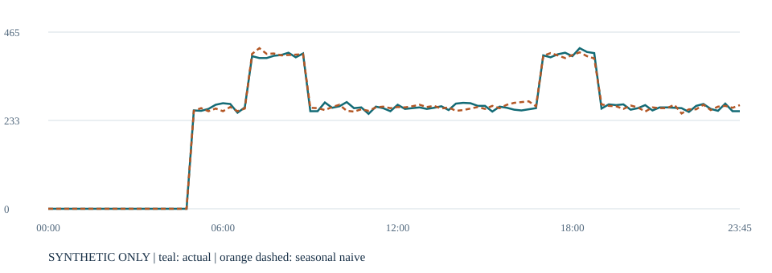

# Urban Transit Demand Forecasting

[](https://github.com/dekelmordejai/urban-transit-demand-forecasting/actions/workflows/ci.yml)


**A reproducible Python prototype for data quality, historical availability and hierarchical transit forecasting baselines.**

This portfolio project turns versioned 15-minute validation counts into auditable station, line and system forecasts. It demonstrates how to preserve missingness, replay information available at each forecast origin, and evaluate simple statistical references before adding machine learning.

**Current scope:** working data controls and statistical baselines with invented data. Real-data validation, ML training and operational deployment remain future work. This is an independent technical demonstration, with no claim of institutional endorsement or production use.

## What to review

| Evidence | What it demonstrates |
| --- | --- |
| [Data quality implementation](src/transit_demand/data/quality.py) | Checksums, reconciliation, dated station membership, completeness and revision handling |
| [Origin-aware baselines](src/transit_demand/models/baselines.py) | Seasonal naive and weekday/time-slot means using D−1 history only |
| [Evaluation and aggregation](src/transit_demand/evaluation/backtest.py) | MAE, WAPE, coverage and conservative bottom-up spatial/temporal sums |
| [Reproducible experiment](docs/reproducible-demo.md) | Deterministic generator, five evaluation origins and complete output inventory |
| [Synthetic results](docs/demo-results.md) | A small, inspectable reference report; not real-world accuracy |
| [Tests](tests/) and [CI runs](https://github.com/dekelmordejai/urban-transit-demand-forecasting/actions) | 41 tests, lint, package build and demo execution on Python 3.11/3.12 |



*One invented system-day at 15-minute resolution. Teal: synthetic observations. Orange dashed: seasonal naive prediction. This illustration does not measure real transit performance.*

## Run the demonstration

```sh
git clone https://github.com/dekelmordejai/urban-transit-demand-forecasting.git
cd urban-transit-demand-forecasting
python -m venv .venv
```

Activate the environment with `.venv\Scripts\Activate.ps1` in Windows PowerShell, or `source .venv/bin/activate` on macOS/Linux. Then:

```sh
python -m pip install -c requirements-demo.txt -e ".[dev]"
python -m pytest
python -m transit_demand demo --output artifacts/synthetic-demo
```

Open `artifacts/synthetic-demo/report.html` for the chart and score table. The command also writes forecasts, quality results, origin snapshots, metrics and SHA-256 checksums. Choose a new or empty output directory for each run. After installation, the demo runs offline and has no database connection. CI attaches the generated synthetic report as a downloadable workflow artifact.

For the small example contract:

```sh
python -m transit_demand quality data/examples/validations.csv --manifest data/examples/delivery-manifest.json --catalog data/examples/station-catalog.json
```

## Design decisions

- **Unknown is not zero.** A missing interval remains unknown unless a complete sparse-delivery declaration explicitly supports zero filling. Capture outages retain their own status.
- **Revisions replace, never accumulate.** A forecast origin selects one available version per partition. A later correction cannot silently change an earlier origin's training snapshot.
- **Stable scoped IDs.** Station identity is `(line_id, station_id)` with dated catalog membership; display names are not keys.
- **Fixed-origin evaluation.** All horizons use the information available at one origin. Synthetic targets are full next local days +1/+2/+3, not exact 24/48/72-hour lead times.
- **Conservative aggregation.** Point forecasts sum station → line → system and 15-minute → hourly → daily. Unknown actuals propagate; incomplete groups fail. This is bottom-up aggregation, not MinT or probabilistic reconciliation.

The illustrative input counts use `TX_3_INGRESO + TX_4_GRATUIDAD + TX_7_TRANSBORDO` as observed entries. Exit counts and unclassified code 0 remain separate. Those are demonstration contract conventions, not a universal fare-system mapping. Counts are recorded entries, not unique travelers or unconstrained demand.

## Scope and roadmap

| Implemented | Planned |
| --- | --- |
| Versioned data contracts and reconciliation | Source-approved real-data adapters and validation |
| Calendar/incident validation and knowledge-time flags | Forecast feature integration and leakage-safe lag healing |
| Two statistical seasonal baselines | Global LightGBM/MLForecast comparison |
| Availability-aware synthetic evaluation | Real out-of-time evaluation and external calibration comparison |
| Deterministic coherent point sums | Validated probabilistic forecasts and covariance reconciliation |

No internal calibration implementation is included or represented as ML. Synthetic metrics support software verification, not claims of real-world predictive accuracy. See [module status](docs/module-status.md) and [roadmap](docs/roadmap.md).

## Project guide

`src/transit_demand/` contains the installable package; `schemas/` the normalized contracts; `data/examples/` only fictional fixtures; `tests/` the automated checks; and `docs/` architecture, reproduction and limitations.

Read [architecture](docs/architecture.md), [data contracts](docs/data-contracts.md), [data governance](docs/data-governance.md), [contributing](CONTRIBUTING.md) and [security](SECURITY.md). Never submit institutional records, credentials or private operational documents to this public repository. No open-source license is assigned to this snapshot; dependency licenses remain their own.
