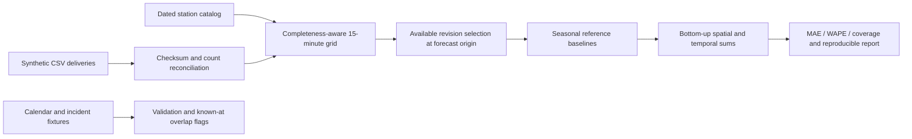

# Architecture

All solid paths above are implemented. Calendar and incident controls are exercised separately: the current baselines do not consume those flags as predictive features. Each forecast origin uses only deliveries available at that origin and excludes current-day observations. Final revised synthetic truth is used only for scoring, not fitted retrospectively into earlier snapshots.

The demo has four fixed fictional stations in two lines, five origin dates and three target-day offsets. Station-level deterministic predictions are aggregated to line and system totals, then to 15/60/1440-minute buckets. Missing actuals propagate rather than becoming artificial zeros. Coverage is reported alongside error metrics.

Modules are intentionally small: data/contracts.py checks CSV structure; data/quality.py validates deliveries and versions; features/catalogs.py validates calendars and incidents; models/baselines.py fits seasonal references; evaluation/backtest.py handles metrics and aggregation; demo.py assembles the reproducible experiment.

Production-scale streaming, real-source adapters, dynamic forecast scopes, trained ML, probabilistic reconciliation and operational decision support are future work. The prototype materializes bounded partitions in memory; no production scale or latency is claimed.
